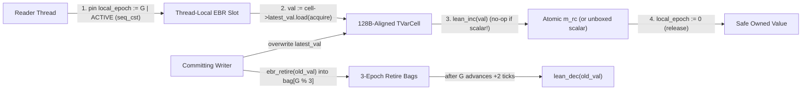
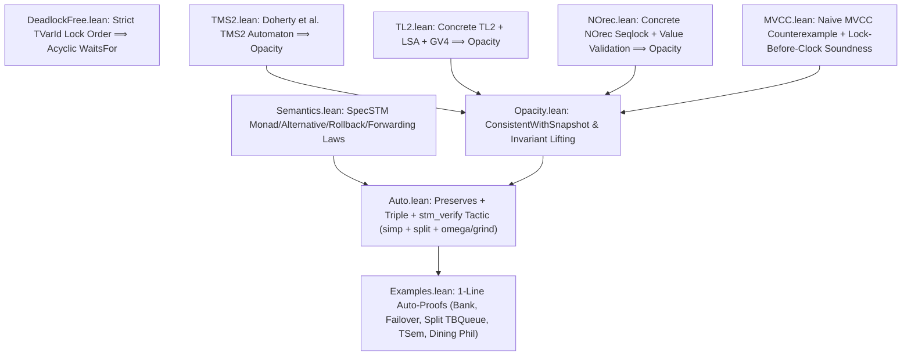

# Building & Verifying Software Transactional Memory in Lean 4 From Scratch

A deep, first-principles systems and theorem-proving guide to implementing `lean-stm` manually: covering Lean 4's Perceus reference-counting runtime internals, ARM64/C++20 memory-ordering subtleties, modern PL STM protocols (`TL2-LSA`, `GV4`, `Hybrid MVCC`, `NOrec`), Dekker-synchronized modular blocking, and mechanized **Opacity** / **TMS2** verification in Lean 4.

---

## 1. Why STM in Lean 4 Is Uniquely Interesting (and Subtle)

Most STM implementations live in one of two worlds:
1. **Garbage-Collected Functional Runtimes** (Haskell GHC `Control.Concurrent.STM`, OCaml 5 `kcas`, Scala `ZSTM` / `CCSTM`): A tracing GC guarantees that reading a pointer out of a shared `TVar` never races with immediate `free()`.
2. **Unmanaged C/C++ Libraries** (`TinySTM`, `TL2`, `NOrec`, `OneFile`): Operate on raw machine words (`uintptr_t`), leaving heap object reclamation entirely to the caller.

**Lean 4 occupies a third point in the design space**: strict pure functional programming backed by **Perceus precise reference counting** (`src/runtime/object.cpp` and `src/runtime/io.cpp`).

### 1.1 The Hidden Bottleneck Inside Lean 4's `IO.Ref`
If you open `~/lean4/src/runtime/io.cpp` around line 1450, you will find how Lean 4 implements `IO.Ref.get` (`lean_st_ref_get`) when an `IO.Ref` is shared across threads:

```cpp
object * val = val_addr->exchange(nullptr);
if (val != nullptr) {
    inc(val);
    object * tmp = val_addr->exchange(val);
    if (tmp != nullptr) dec(tmp);
    return val;
}
```

**Why did Lean's runtime authors write a spinloop with TWO `atomic::exchange` operations just to *read* a reference?!**
Because `lean_ref_object` stores only a single 8-byte pointer `m_value`. If Thread R simply loaded `val = m_value` non-destructively, Thread W could overwrite `m_value` and execute `lean_dec(val)` (freeing `val` when its refcount hits 0) *before* Thread R executed `lean_inc(val)`! To prevent that use-after-free without a GC, `lean_st_ref_get` temporarily **steals** the pointer (`exchange(nullptr)`), increments its refcount, and puts it back.

Consequence: **On a 16-core Apple M4 Max, even a 100% read-only workload on a shared `IO.Ref` turns every read into two cache-line-invalidating atomic RMW writes and causes concurrent readers to spin on `nullptr`!**

### 1.2 The `lean_mark_mt` Invariant
In Lean 4 (`lean.h` lines 535–612), heap objects are born **single-threaded** (`m_rc > 0`), using cheap non-atomic `m_rc++` / `m_rc--` instructions (enabling Perceus functional-but-in-place mutation when `m_rc == 1`).
When an object becomes reachable from shared state, the runtime calls `lean_mark_mt(obj)` (`object.cpp:630`), which walks the reachable object graph and negates `m_rc` (`m_rc < 0`). Once `m_rc < 0`:
- `lean_inc_ref` uses `atomic_fetch_sub_explicit(&o->m_rc, 1, memory_order_relaxed)`.
- `lean_dec_ref` calls `lean_dec_ref_cold`, which uses an `acq_rel` atomic fetch-add and frees when reaching `0`.
- `lean_is_exclusive(o)` returns `false`, safely disabling destructive in-place reuse on shared immutable values.

> **Rule 1 for Coding `lean-stm` Yourself**: Every `lean_object*` stored in a `TVar` (and the `LeanExternal` `TVar` wrapper itself) **MUST** pass through `lean_mark_mt` *before* any pointer to it is published to another thread.

---

## 2. Eliminating Read Contention with Fraser Epoch-Based Reclamation (EBR)

How do we let 16 cores read the same `TVar` simultaneously with **zero writes to the `TVar`'s cache line** while keeping Perceus reference counting 100% memory-safe?

We pair `lean_mark_mt` with **3-Epoch Fraser Epoch-Based Reclamation** (originally invented by Keir Fraser in his 2004 Cambridge PhD dissertation *Practical Lock-Freedom* specifically for lock-free STM!):



### Step-by-Step Manual Implementation Recipe (`c/lean_stm.cpp`)
1. **Scalar Short-Circuit (`lean_is_scalar`)**: In Lean 4, `Nat` values $< 2^{63}$, `Bool`, `Unit`, `UInt8`/`UInt16`/`UInt32`, and fieldless enum constructors are **tagged pointers** (`(n << 1) | 1`). `lean_is_scalar(o)` checks `(size_t)o & 1`. Scalars are never heap-allocated, so `ebr_retire` returns immediately in 1 cycle and `lean_inc` is a no-op!
2. **Thread-Local EBR Pinning (`ebr_enter` / `ebr_exit`)**:
   - Global epoch `g_ebr_epoch` starts at `1`.
   - Before dereferencing/incrementing a `lean_object*` from a `TVarCell`, the reader writes `local_epoch.store(g | EBR_ACTIVE_BIT, seq_cst)` to its **own** 128-byte-aligned thread-local node (no cross-core cache invalidation unless the global epoch advances!).
   - After `lean_inc(val)` completes, the reader stores `local_epoch.store(0, release)`.
3. **Deferred `lean_dec` (`ebr_retire`)**:
   - When a writer replaces `old_val` at global epoch $G$, it does **not** call `lean_dec(old_val)` immediately. It appends `old_val` to `bags[G % 3]`.
   - Every 64 heap retires, `ebr_try_advance` checks whether all active threads have `local_epoch == G` (or quiescent `0`). If so, it advances `G -> G + 1` via `CAS` and calls `lean_dec` on `bags[(G + 2) % 3]` (objects retired at $G - 1$, now 2 full epoch transitions old).
   - In `~EbrThreadGuard()` (thread exit destructor), any remaining thread-local bags are spliced into `g_ebr_orphan_bags` under `g_ebr_mtx` so zero objects leak when `IO.asTask` worker threads terminate.

---

## 3. Multi-Protocol Concurrency Control Architecture

To study modern PL tradeoffs both formally and empirically, `lean-stm` implements four protocols behind a unified ABI:

### 3.1 `TL2-LSA + GV4` (Default Production Engine)
Classical **TL2** (*Dice, Shalev, Shavit, DISC 2006*) maintains a global version clock `g_tl2_clock` and a per-`TVar` `lock_ver` word (`bit 0` = write-locked, `bits 1..63` = version). Vanilla TL2 suffers from two well-known scalability bottlenecks that modern PL work solved:

1. **Spurious Aborts from Unrelated Commits -> Lazy Snapshot Extension (`LSA`, Riegel et al., DISC 2006)**:
   - In vanilla TL2 (`Protocol.tl2Gv1`), if `tx` starts at `rv = 10` and later reads `TVar Y` whose version is `11` (updated by an unrelated transaction on another core), `tx` immediately aborts — even if nothing in `tx`'s own `read_log` changed!
   - With **LSA** (`tl2_try_extend_snapshot`), when `ver > tx.rv`, `tx` loads `new_rv = g_tl2_clock.load(acquire)` and checks whether every `(cell, rver)` in `tx.read_log` is still unlocked at version `rver`. If so, `tx` **advances `tx.rv := new_rv` in-place** and continues without aborting!
   - We mechanically prove this sound in [`TL2.lean`](STM/Verify/TL2.lean) (`Step.extendSnapshot`).

2. **Central Clock Cache-Line Bouncing -> Read-Only Fast Path + Post-Lock `GV4` CAS Clock**:
   - **0-Write Fast Path**: If `write_set.empty()` at commit time, every read was already validated at `tx.rv`. Commit returns `true` immediately without touching a single lock or incrementing `g_tl2_clock`!
   - **Safe Post-Lock `GV4` CAS Clock**: After acquiring all write locks in strictly ascending `TVarCell::id` order, the writer loads `c = g_tl2_clock.load(seq_cst)` and attempts `CAS(c, c + 1)`.
     - If CAS succeeds: `wv = c + 1`.
     - If CAS fails with observed value `c' > c`: another writer bumped the clock *after* our locks were already held! Choosing `wv = c'` elides a redundant atomic RMW on `g_tl2_clock` while strictly increasing every locked `TVar`'s version (`old_ver <= c < c'`, proved in `TL2State.gv4_post_lock_strictly_advances`).

### 3.2 Wait-Free Read-Only Snapshots via Inline-Ring `MVCC` (`atomicallyReadOnly`)
Even with LSA, a long read-only transaction scanning 32 hot `TVar`s while 8 writer threads furiously mutate those *exact* 32 `TVar`s will starve in optimistic TL2/NOrec because an earlier read always changes before the 32nd read finishes.

To eliminate read starvation completely, each `TVarCell` embeds an **8-slot circular version ring** (`VersionSlot ring[8]`).
- **The Subtlety Our Prover Caught (`STM/Verify/MVCC.lean`)**:
  If a writer increments `g_tl2_clock` to `wv` *before* locking all `TVar`s in its write-set (or if a reader ignores active write locks), a reader at `rv = wv` can observe `acc[0]` post-transfer (`984`) and `acc[1]` pre-transfer (`1000`), seeing `1984 != 2000`! (This exact bug surfaced at `7984 != 8000` when `NOrec` writers initially omitted per-cell lock bits!)
- **The Lock-Before-Clock Protocol**:
  1. Writers **must** set `cell->lock_ver |= 1` on **every** `TVar` in `write_set` *before* incrementing `g_tl2_clock` to `wv`, and only clear the lock bit *after* publishing `(wv, new_val)` into `cell->ring`.
  2. In `mvcc_read_at(cell, rv)`, the reader spins briefly while `cell->lock_ver & 1` is set (~10ns pointer writeback), then scans `cell->ring` for the maximum `ver <= rv`.
  - By `lock_before_clock_mvcc_sound` (`tLock < tClock <= tSnap < tObs`), any writer with `wv <= rv` was already holding `cell`'s lock at `tSnap`, so observing `cell` unlocked at `tObs` guarantees `(wv, val)` is already in `cell->ring`!

### 3.3 `NOrec` Engine (`Dalessandro, Spear, Scott, PPoPP 2010`)
`Protocol.norec` abolishes per-object ownership records in favor of a single global sequence lock `g_norec_loc` and value-based validation.
- **Perceus Synergy**: In C/C++, value-based pointer validation risks the **ABA problem** if an object is freed and a new object is allocated at the same address. In Lean 4, because `tx.read_log` holds `+1` RC on every read `lean_object*` until the transaction ends, the allocator **cannot** recycle that address during the transaction — making pointer equality `cell->latest_val == r.val` 100% ABA-free!

---

## 4. Composable `orElse` (`<|>`) & Dekker-Synchronized `retry`

Harris, Marlow, Peyton Jones & Herlihy (*PPoPP 2005*) introduced two combinators that elevate STM from "optimistic locks" to a true concurrency algebra:

### 4.1 Nested Savepoints in `orElse` (Retaining Failed Read-Sets!)
When `t1 <|> t2` runs:
1. Push `Savepoint{ write_set.size(), undo_log.size() }`.
2. Any overwrite in `t1` of an entry below `savepoint.write_size` logs its old value to `undo_log`.
3. If `t1` calls `retry`, `rollback_to_savepoint` replays `undo_log` in LIFO order and truncates `write_set` — **but intentionally leaves `read_log` intact!**
   *Why?* Suppose `t1` read `chA` (saw `empty`) and called `retry`, and `t2` read `chB` (saw `empty`) and called `retry`. The thread **must** sleep on `chA ∪ chB`, because a message arriving on *either* channel makes `t1 <|> t2` ready to succeed! And if `t2` *succeeds*, committing `t2` must still validate `chA` so `t2` only commits in a snapshot where `t1` genuinely could not have succeeded!

### 4.2 Zero-Lost-Wakeup Parking via Dekker's Protocol
To avoid polling timeouts or spinloops on `retry`, `park_on_read_set` and `commit_*` form a symmetric Dekker pair around `seq_cst` fences:
- **Parker (under `cell->wait_mtx`)**:
  1. Link `WaitNode` and execute `cell->has_waiters.fetch_add(1, seq_cst)`.
  2. `atomic_thread_fence(seq_cst)`.
  3. Re-check `cell->lock_ver.load(acquire) == (expected_ver << 1)`. If locked or changed, abort sleep immediately!
- **Committer (after releasing `cell->lock_ver`)**:
  1. Store unlocked new version `cell->lock_ver.store(wv << 1, release)`.
  2. Execute **one** transaction-wide `atomic_thread_fence(seq_cst)`.
  3. Load `cell->has_waiters`: on the 99.99% uncontended path it is `0` (zero mutexes touched!); if `> 0`, acquire `cell->wait_mtx` and signal `cv.notify_all()`.

By total ordering of `seq_cst` fences, either the parker sees the new version and skips sleeping, or the committer sees `has_waiters > 0` and wakes the parker.

---

## 5. How the Mechanized Proof Architecture Fits Together (`STM/Verify/`)



To verify your own transactional invariant with `stm_verify`:
1. Mark your state invariant and `SpecSTM` operation with `@[stm_simp]`.
2. State `theorem my_op_safe : Preserves MyInv myOp := by stm_verify`.
3. `stm_verify` unfolds `Preserves`, symbolically executes all `do`, `check`, and `<|>` branches, splits path conditions in both goal and hypotheses, and dispatches every leaf obligation to `omega` and `grind`!
