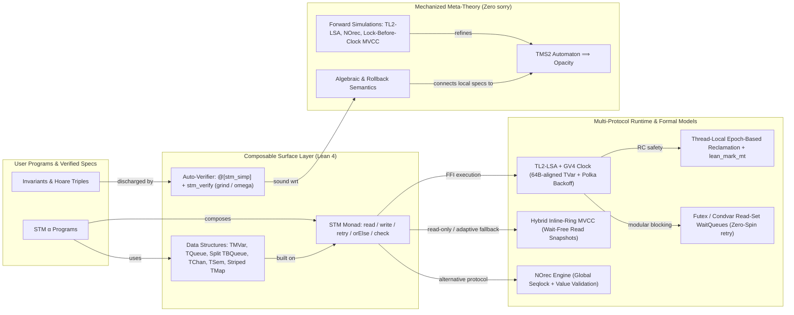

# `lean-stm` — Design & Verification Specification

## 1. Overview & Motivation

Lean 4 features a high-performance task scheduler and functional-but-in-place (FBIP) reference-counted runtime (`Perceus`), yet lacks native **Software Transactional Memory (STM)**. Furthermore, inspecting Lean 4's runtime (`src/runtime/io.cpp`) reveals a critical concurrency bottleneck in `IO.Ref`: every multi-threaded read (`lean_st_ref_get`) executes **two sequential `atomic::exchange` operations** (temporarily writing `nullptr` into the cell while incrementing the reference count), turning even 100% read-only workloads into cache-line-dirtying spinloops.

`lean-stm` bridges modern Programming Languages concurrency research and Interactive Theorem Proving in a zero-dependency Lean 4.35 package:
1. **Production Composable STM API** modeled on Harris, Marlow, Peyton Jones & Herlihy (*Composable Memory Transactions*, PPoPP 2005), OCaml 5 `kcas` (Karvonen & Sivaramakrishnan, 2023–2024), and Software Transactional Objects (`STO`, Herman et al., EuroSys 2016).
2. **Multi-Protocol C++20 Atomic Engine** engineered specifically for Lean 4's multi-threaded reference counting (`lean_mark_mt`) using **Fraser Epoch-Based Reclamation (EBR)** so readers never mutate `TVar` cache lines, supporting **TL2-LSA + GV4**, **Hybrid Inline-Ring MVCC**, and **NOrec**.
3. **Zero-`sorry` Mechanized Verification Suite (`STM.Verify`)** proving algebraic laws, **Guerraoui-Kapalka Opacity** via **Doherty et al. TMS2** forward simulation, **Deadlock Freedom**, **LSA Snapshot Extension soundness**, **Lock-Before-Clock MVCC soundness** (plus a mechanized counterexample to naive MVCC), and a push-button **`stm_verify`** Hoare-logic tactic powered by `grind` and `omega`.

---

## 2. Architecture Diagram

---

## 3. PL Research Synthesis & Algorithmic Choices

| Challenge | Classic Approach | Modern PL Solution in `lean-stm` | Reference |
| :--- | :--- | :--- | :--- |
| Lean `IO.Ref` read contention (`exchange(nullptr)`) | Per-access mutex or pointer stealing | **Fraser EBR + `lean_mark_mt`**: readers load `atomic<lean_object*>` with `acquire` inside thread-local epoch pin; overwritten pointers retired via 3-epoch bags | Fraser (PhD 2004); Perceus / Lean 4 Runtime |
| Central clock cache-line bouncing in TL2 | `global_clock.fetch_add(2)` on every tx | **Read-only 0-write fast path** (zero clock touch) + **GV4 CAS Clock** (`compare_exchange` deduplicating concurrent clock advances) | Dice, Shalev, Shavit (DISC 2006); Lev et al. |
| Spurious aborts from unrelated writes | Abort immediately when `ver > rv` | **Lazy Snapshot Extension (LSA)**: re-validate existing read-set against current `global_clock` and advance `rv` in-place | Riegel, Felber, Fetzer (*LSA*, DISC 2006) |
| Long read-only tx starvation under heavy writes | Repeated optimistic aborts | **Hybrid Inline-Ring MVCC**: 8-slot `(ver, val)` ring per `TVar` + Lock-Before-Clock ordering (`t_lock < t_clk < t_unlock`) for 0-abort wait-free snapshots | Fernandes & Cachopo (*JVSTM*, PPoPP 2011); Perelman et al. (PODC 2010) |
| Low-thread metadata overhead comparison | Per-word locks only | **Selectable `NOrec` Engine**: single global sequence lock + value validation | Dalessandro, Spear, Scott (*NOrec*, PPoPP 2010) |
| Busy-waiting on unmet preconditions | Spin loops | **Modular `retry` + `orElse` (`<|>`)**: nested write-log savepoints preserving failed read-sets; deterministic sorted parking on per-`TVar` wait queues | Harris, Marlow, Peyton Jones, Herlihy (PPoPP 2005); Karvonen (`kcas`, 2023) |
| Container-level false conflicts | Whole-container `TVar` | **Split-Counter `TBQueue`** (`readCap` vs `writeCap`) & **Striped `TMap`** | Marlow (GHC `TBQueue`); Herman et al. (*STO*, EuroSys 2016) |

---

## 4. Module Layout

- `c/lean_stm.cpp`: C++20 multi-protocol STM runtime (TL2-LSA/GV4, Hybrid MVCC 8-slot ring, NOrec, EBR, WaitQueues, Polka contention backoff, telemetry counters).
- `STM/FFI.lean`: Low-level `@[extern]` declarations with `@&` borrowed ABI annotations.
- `STM/Core.lean`: Safe typed `TVar α`, `STM α` monad (`Alternative`, `MonadExcept`), `atomically`, `atomicallyWith`, `readOnly`, `retry`, `orElse`, `check`, runtime protocol selector & live profiling stats.
- `STM/PureRef.lean`: 100% pure Lean `Std.Mutex`/`Condvar` reference STM for differential testing and baseline benchmarking.
- `STM/Data/`:
  - `TMVar.lean`, `TQueue.lean`, `TBQueue.lean`, `TChan.lean`, `TSem.lean`, `TMap.lean`
- `STM/Verify/`:
  - `Semantics.lean`: Pure executable specification of composable `STM` + algebraic laws (`retry`/`orElse`/read-write forwarding).
  - `Opacity.lean`: Formal definition of histories, real-time order, sequential legality, and Guerraoui-Kapalka Opacity.
  - `TMS2.lean`: Doherty et al. TMS2 automaton + mechanized proof `TMS2 ⟹ ConsistentReadViews ∧ StrictSerializability`.
  - `DeadlockFree.lean`: Strict `TVarId` lock ordering DAG proof.
  - `TL2.lean`: Concrete TL2 + LSA state machine & forward simulation to TMS2.
  - `NOrec.lean`: Concrete NOrec state machine & snapshot consistency / serializability proof.
  - `MVCC.lean`: Mechanized counterexample to naive lock-ignoring MVCC + mechanized soundness proof of Lock-Before-Clock MVCC.
  - `Auto.lean`: Transactional Hoare triples, global concurrent schedule lifting, and `stm_verify` tactic (`@[stm_simp]` + `grind` + `omega`).
  - `Examples.lean`: Auto-verified invariants for Bank Transfers, Failover `orElse`, `TMVar`, Split `TBQueue`, `TSem`, and Dining Philosophers.
- `Tests/Main.lean`: Property, concurrency stress, linearizability/conservation, `retry`/`orElse` wakeup, and EBR memory-stress test suite.
- `Bench/Main.lean`: 16-core Apple M4 Max benchmark suite + autoresearch experiment harness.
